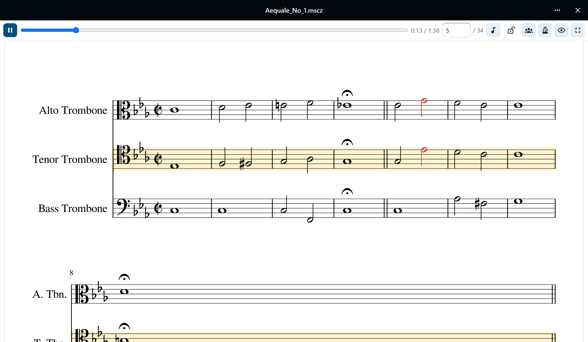
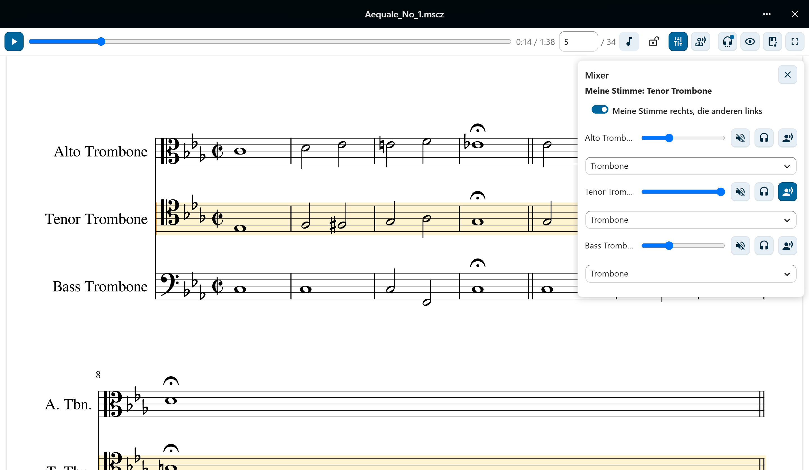
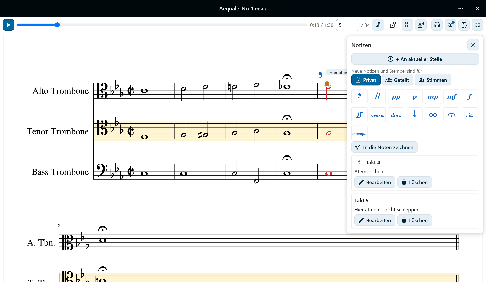
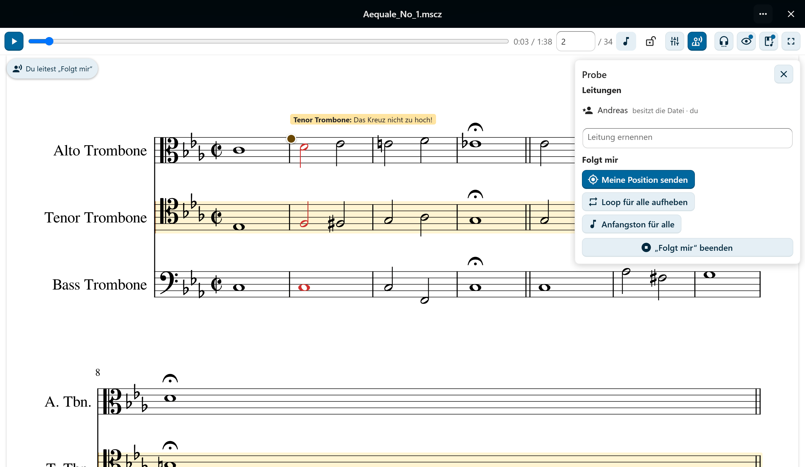
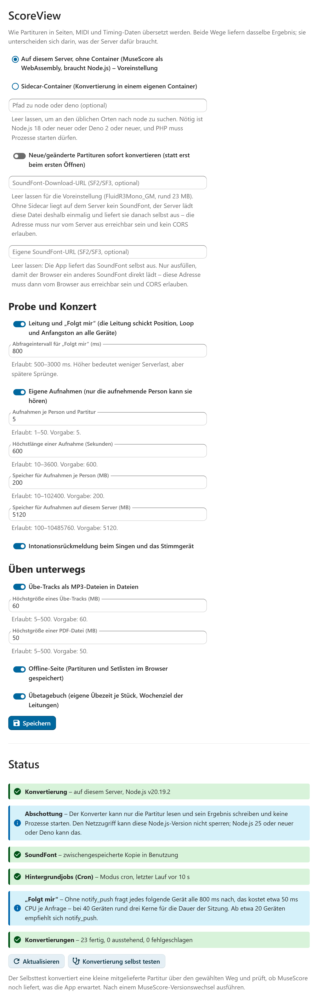

<!-- translation-of: README.md sha256:741111cc9e92 -->
# ScoreView

[English](README.md) · **Deutsch** — Die englische Fassung ist maßgeblich.

[](https://github.com/AndiMb/scoreview/actions/workflows/ci.yml)
[](LICENSE)

Nextcloud-App, die MuseScore-Partituren direkt aus Files anzeigt und im Browser
abspielt – als originalgetreue MuseScore-Notation mit einem Wiedergabe-Cursor,
der synchron mitläuft, statt als starrer PDF-Export.

Gedacht für Chor- und Ensemblearbeit: Die Noten sehen aus wie die eigenen Noten,
jede Stimme ist einzeln hörbar, und jeder Takt ist in einem Klick erreichbar.



## Was die App kann

**Noten lesen.** MuseScores eigenes Seitenbild als Vektorgrafik – Zoom ohne
Qualitätsverlust, Zoom-Presets, Vollbild, und ein Autoscroll, das den laufenden
Takt im Sichtband hält – oder, abgeschaltet, die Ansicht dort lässt, wo man sie
hingeschoben hat. Wie die klingende Stelle markiert wird, entscheidet
jede Nutzerin selbst: eingefärbte Notenköpfe oder ein Band, in einer frei
wählbaren Farbe. Auf einem breiten Bildschirm stehen zwei Seiten
nebeneinander wie in einem aufgeschlagenen Heft – mit Seite 1 links oder
allein rechts. **Drucken** öffnet alle Seiten der Partitur in ihrem eigenen
Seitenformat für den Druckdialog des Browsers – auf Papier oder als PDF, mit
oder ohne die eigenen Notizen und Stempel, mit oder ohne Tonnamen –, und
**Als PDF in Dateien speichern** legt eine PDF des Notenbilds neben die
Partitur. Die Suche von Nextcloud findet eine Partitur über Titel und
Komponist, nicht nur über den Dateinamen.

**Hören, was man üben will.** Die Wiedergabe wird im Browser synthetisiert, nicht
als fertiges MP3 abgespielt. Deshalb lässt sich pro Stimme die Lautstärke regeln,
stummschalten und solo hören, das Tempo in BPM ändern und ein Metronom
zuschalten – auf jedem Schlag, nur auf dem Taktanfang oder mit einem leiseren
Klick auf jedem Achtel. „Meine Stimme" hebt eine Stimme hervor und lässt die
übrigen leise mithörbar.



**Gezielt proben.** Taktnavigation mit dauerhaft sichtbarer Taktangabe, ein Loop
über einen frei gewählten Taktbereich mit Markierung im Notenbild, und ein Klick
auf eine Note springt genau dorthin. **Nur den Loop zeigen** blendet alles
außerhalb der Stelle zurück, und ein Loop lässt sich mit Namen **speichern** –
privat, geteilt oder von einer Leitung für bestimmte Stimmen – und mit einem
Tipp wieder setzen.

**Notizen machen.** Privat oder mit allen geteilt, die die Datei sehen. Sie
hängen an einer musikalischen Position statt an Pixeln und überstehen deshalb
ein Neurendern und einen Re-Upload derselben Partitur. Wo kein Stempel passt,
lässt sich mit Finger, Stift oder Maus **in die Noten zeichnen** – ein Bogen,
ein Kreis um ein Intervall; die Zeichnung hält sich an ihren Takt und an die
Notenzeile ihrer Stimme, auch auf Handyseiten und im Stimmenauszug.



**Auf dem Tablet am Notenständer.** Touch-Bedienung, Pinch-Zoom und ein
Bildschirm, der während der Wiedergabe nicht schlafen geht. Im
**Aufführungsmodus** wirken nur noch Blättern, Zoom und der Wechsel zum nächsten
Stück – ein versehentlicher
Tipp löst nichts aus –, und `Bild↓`/`Bild↑` oder ein Bluetooth-Pedal blättern so
weiter, dass keine Zeile verloren geht. Auf Wunsch helle Noten auf dunklem
Grund, eingebettete Bilder bleiben dabei unverändert.

**Üben.** Der **Anfangston** spielt, solange man den Knopf hält, den Ton der
eigenen Stimme an der aktuellen Stelle oder den Grundton der Tonart. „Meine
Stimme“ merkt sich die App je Partitur und legt sie auf Wunsch rechts ins
Stereobild, die übrigen links. Der **Speed-Trainer** steigert das Tempo mit
jedem Loop-Durchlauf bis zum Zieltempo. **Coach** spielt die eigene Stimme als
Klavier laut und rechts, die übrigen leise links, und **Transponieren** setzt
den Klang um Halbtöne höher oder tiefer – und, wo der Server es setzt, die
Noten mit.

**Die eigene Stimme, gesetzt.** Die **Fassung** zeigt eine Stimme für sich
statt der Partitur: die in der Datei gespeicherten Auszüge oder einen, den
MuseScore für jede andere Stimme erzeugt. Transponierende Instrumente lassen
sich **klingend** zeigen. MuseScore setzt das jeweils selbst, beim ersten
Wählen, und Klang, Notizen und Taktzahlen bleiben die der Partitur
([Darstellungsvarianten](docs/limits.de.md#darstellungsvarianten)).

**Unterwegs üben, am Handy lesen.** Ein **Übe-Track** speichert genau das, was
man gerade hört – Stimme, Coach, Tempo, Transposition, auf Wunsch nur den
Loop oder mit Metronom – als MP3 neben der Partitur in Files; die
Nextcloud-App spielt ihn offline und mit Steuerung auf dem Sperrbildschirm.
Wer neben der Partitur schreiben darf, erzeugt mit einem Klick **Tracks für
alle Stimmen**. Zum Lesen auf dem Telefon setzen **Handyseiten** die Partitur auf
Seiten in Bildschirmgröße, mit größeren Noten; das **Systemband** stellt die Systeme
nebeneinander, jedes so hoch wie der Bildschirm, und die **Liedtext-Ansicht**
zeigt nur den Text der eigenen Stimme mit allen Strophen, die gesungene Silbe
hervorgehoben – oder mit **Alle Stimmen** den Text jeder Stimme Zeile für
Zeile, und es leuchtet, wer gerade singt. **Tonnamen** stehen auf Wunsch neben den Notenköpfen – deutsch,
englisch oder als Solmisation –, und ein Tipp auf eine Note spielt ihren Ton;
**Zählzeiten** („1 + 2 +“) stehen auf Wunsch über der eigenen Notenzeile.
Mit **„Offline vormerken“** liegen ein Stück oder eine ganze Setliste samt
Klang im Browser bereit und öffnen sich ohne Netz über die Offline-Seite der
App.

**In der Chorprobe.** Wer eine Partitur besitzt, ernennt **Leitungen**, und jede
Leitung kann weitere ernennen. Leitungen schreiben **Stimmnotizen**, die nur die
angesprochenen Stimmen sehen – wer noch keine Stimme gewählt hat, sieht sie
zurückgenommen mit dem Namen der Stimme. Dazu kommen **Stempel** (Atemzeichen,
Zäsur, Dynamik, Fermate …), die an der musikalischen Stelle im Notenbild stehen. Die
Taktnavigation versteht **Studierbuchstaben**: „C“ und „C+3“ springen dorthin.
Mit **„Folgt mir“** schickt die Leitung Stelle, Loop, Anfangston und eine
Transposition an alle Geräte im Raum, lässt sie beim eigenen Abspielen stumm
mitblättern und nimmt sie in der Setliste zum nächsten Stück mit – wer selbst
navigiert, löst sich und kommt mit einem Tipp
zurück.



**Im Konzert.** Eine **Setliste** ist eine Datei `*.setlist.md` in Files, eine
Liste von Links auf Partituren, im Texteditor oder in ScoreView bearbeitbar.
Im Viewer geht es von Stück zu Stück, ohne dass Aufführungsmodus, Zoom oder
SoundFont neu geladen werden.

**Sich selbst hören.** **Eigene Aufnahmen**, synchron zu Cursor und Begleitung
abspielbar, hört nur, wer sie gemacht hat – es sei denn, eine Leitung **gibt**
eine ihrer Aufnahmen **für Stimmen frei**: Dann hören die Sängerinnen und
Sänger dieser Stimmen ihre Stimme von der Leitung vorgesungen, synchron zur
Partitur. Die **Rückmeldung zur Intonation**
zeigt beim Singen eine Nadel am Cursor und danach die Stellen, die zu hoch oder
zu tief, zu früh oder zu spät oder zu kurz waren. Zum Töne-Lernen hält der
**Warte-Modus** vor jeder Note der eigenen Stimme an, bis sie gesungen wird.
Das **Stimmgerät** zeigt den gesungenen Ton mit Oktave, Frequenz und
Abweichung in Cent, geschrieben nach der Tonart an der aktuellen Stelle; sein
Stimmton a′ (420–460 Hz) stimmt auch Intonation und Wiedergabe.
Das Mikrofon läuft nur auf ausdrücklichen Wunsch, ein roter Punkt zeigt wofür.

**Dranbleiben.** Das **Übetagebuch** zählt die Minuten, in denen eine
Partitur spielt oder man aufnimmt – je Tag und je Stück, mit Tagen in Folge.
Leitungen können für ein Stück ein Wochenziel setzen. Die eigene Zeit sieht
nur man selbst: keine Leitung, keine Bestenliste.

Das geht auch in den mobilen Nextcloud-Apps, mit wenigen Einschränkungen: Das
Mikrofon gibt die Android-App nicht frei, dort führt „Im Browser öffnen“ weiter.
Und eine Setliste öffnet sich mobil über eine ihrer Partituren statt über die
Datei selbst. Die Offline-Seite gibt es nur im Browser, nicht in den Apps.
Liedtext-Ansicht und Tonnamen brauchen den lokalen Konvertierungsweg (siehe
unten). Die Verwaltung kann „Folgt mir“, Aufnahme, Intonation, Übe-Tracks, das
Übetagebuch und die Offline-Seite einzeln abschalten; was die Funktionen kosten und wo sie
enden, steht in docs/limits.de.md unter
[Probe- und Konzertfunktionen](docs/limits.de.md#probe--und-konzertfunktionen)
und [Üben und Lesen auf dem Handy](docs/limits.de.md#üben-und-lesen-auf-dem-handy).

Tastatur im Viewer: `Leertaste` Start/Stopp · `←` `→` Takt zurück/vor · `L` Loop
· `+` `−` Zoom · `0` Seitenbreite · `Bild↓` `Bild↑` blättern · `Strg+P` drucken.

Oberfläche auf Deutsch und Englisch; weitere Sprachen sind willkommen (siehe
[Mitarbeiten](#mitarbeiten)).

## Wie es funktioniert

Eine hochgeladene `.mscz`-Datei wird **einmalig** serverseitig zu Notenseiten
(SVG), MIDI und Timing-Daten konvertiert und das Ergebnis gecacht. Erneutes
Öffnen rendert nicht neu; eine neue Konvertierung stößt eine Änderung an der
Datei an – oder der Knopf „Neu konvertieren" im Viewer, wenn eine neuere Fassung
der App dieselbe Partitur besser setzt. Daneben steht, über welchen der beiden
Wege unten die angezeigten Seiten gesetzt wurden. Die Audiowiedergabe passiert
clientseitig im Browser, mit einem SoundFont, das die App selbst ausliefert.

Für die Konvertierung gibt es **zwei gleichwertige Wege**, die dasselbe
Ergebnis liefern und sich nur darin unterscheiden, was der Server dafür braucht:

| | **Lokal** (Voreinstellung) | **Sidecar** |
|---|---|---|
| Braucht | Node.js ≥ 18 auf dem Nextcloud-Server | einen Docker-Host |
| MuseScore | MuseScore 4.7.6 als WebAssembly, im App-Paket | dieselbe Engine (Voreinstellung) oder echtes MuseScore 4, im Container |
| Einzurichten | nichts | Container starten, Adresse und Secret eintragen |
| Liedtext-Ansicht, Tonnamen, eingefärbte Notenköpfe, Stimmenauszüge | ja | ja mit der Engine, nein mit MuseScore selbst |
| Empfohlen, wenn | keine Container laufen | ohnehin welche laufen |

Der lokale Weg ist voreingestellt, weil er der einzige ist, der nach
`app:enable` schon fertig ist. Ausführlich in
[docs/architecture.md](docs/architecture.md).

Kann der Server **keinen von beiden** ausführen – verwaltetes Hosting ohne
Node-Laufzeit und ohne Container –, konvertiert der Browser der Nutzerin:
dieselbe Engine, dasselbe Ergebnis, aber ohne Cache und mit gut 7 MB
einmaligem Download je Gerät
([E7](docs/architecture.md#e7-konvertierung-im-browser-als-rückfall)). Dieser
Rückfall ist nirgends wählbar und greift nur, wo sonst gar nichts liefe.

## Voraussetzungen

- Nextcloud 35, PHP 8.3–8.5
- Einer der beiden Konvertierungswege oben – oder keiner: Wo verwaltetes
  Hosting weder Container noch eine Node-Laufzeit erlaubt, springt der Rückfall
  im Browser ein
  ([E7](docs/architecture.md#e7-konvertierung-im-browser-als-rückfall)). Warum
  serverseitiges Rendern dort nicht geht, steht unter
  [E3](docs/architecture.md#e3-zwei-konvertierungswege-hinter-einer-api).

## Installation

```sh
occ app:enable scoreview
```

Mehr ist für die Konvertierung nicht nötig: Voreingestellt ist der lokale Weg,
und was er außer einer Node.js-Laufzeit braucht, liegt im App-Paket. Das SoundFont holt der Server beim
ersten Abspielen selbst (~23 MB, FluidR3Mono_GM) – auch dafür ist nichts
einzutragen.

Wer stattdessen den Sidecar fahren will, startet ihn zusätzlich, wählt ihn
unter **Einstellungen → Verwaltung → ScoreView** aus und erlaubt Nextcloud den
Zugriff auf lokale Adressen (`allow_local_remote_servers`, siehe
[Anleitung](docs/installation.de.md#weg-b-sidecar)):

```sh
docker build -f sidecar/Dockerfile -t scoreview-musescore-cli .
docker network create scoreview-net
docker network connect scoreview-net <nextcloud-container>
docker run -d --name scoreview-sidecar --network scoreview-net \
  -e SCOREVIEW_SIDECAR_SECRET="$(openssl rand -hex 32)" \
  --memory=2g --pids-limit=512 scoreview-musescore-cli
```



So oder so fehlt noch ein einmaliger Schritt: Background-Jobs im Modus `cron`.
Daran hängen die Konvertierung und das Eintragen des Mimetypes für `.mscz`, das
die App selbst übernimmt:
**[vollständige Anleitung](docs/installation.de.md)**.

Für „Folgt mir“ mit vielen Geräten lohnt sich
[notify_push](https://github.com/nextcloud/notify_push): Ohne fragt jedes
Gerät während einer Sitzung selbst nach, was bei 40 Geräten zwei bis drei
Prozessorkerne bindet
([Einrichtung](docs/installation.de.md#probe-und-konzert)).

## Dokumentation

| Dokument | Inhalt |
|---|---|
| [Installation und Konfiguration](docs/installation.de.md) | Einrichtung Schritt für Schritt, Einstellungen, Aktualisieren |
| [Architektur](docs/architecture.md) | Aufbau, Entwurfsentscheidungen, Datenfluss, Formatgrundlagen |
| [Grenzwerte und Einschränkungen](docs/limits.de.md) | Gemessene Werte, bekannte Lücken, was die App bewusst nicht tut |
| [Troubleshooting](docs/troubleshooting.de.md) | Fehlerbilder und was hilft |
| [Entwicklung](docs/development.md) | Bauen, testen, Konventionen, Release |
| [Sidecar](sidecar/README.md) | Betrieb und HTTP-API des Konvertierungsdienstes |

Was sich von Fassung zu Fassung geändert hat, steht im
[Changelog](CHANGELOG.md).

## Mitarbeiten

Siehe [CONTRIBUTING.md](CONTRIBUTING.md). Fehler und Wünsche gehören in die
[Issues](https://github.com/AndiMb/scoreview/issues). Wie man eine Übersetzung
beiträgt, steht englisch in [docs/translating.md](docs/translating.md).

## Lizenz und Herkunft

ScoreView steht unter AGPL-3.0-or-later, siehe [LICENSE](LICENSE).

- Die Notensatz- und Konvertierungsarbeit macht **MuseScore Studio** (GPL-3.0) –
  über die [scoreview-engine](https://github.com/AndiMb/scoreview-engine),
  MuseScores Notensatz Qt-frei nach WebAssembly übersetzt – lokal, im Browser
  und im Sidecar – oder, wenn so gewählt, im Sidecar als gepinntes AppImage.
- Das **SoundFont** für die Wiedergabe ist voreingestellt `FluidR3Mono_GM`
  (MIT), dasselbe, das MuseScore mitbringt. Mit Sidecar stammt es aus dessen
  MuseScore-Installation (MuseScore General von S. Christian Collins, MIT),
  sonst holt der Server es von einer voreingestellten, überschreibbaren
  Adresse.
- Übe-Tracks kodiert im Browser
  [`@breezystack/lamejs`](https://www.npmjs.com/package/@breezystack/lamejs) (LGPL-3.0).
- Die Partitur auf den Bildern ist Anton Bruckners *Aequale Nr. 1* in der
  [OpenScore-Ausgabe](https://musescore.com/openscore/scores/4074271) (CC0).
