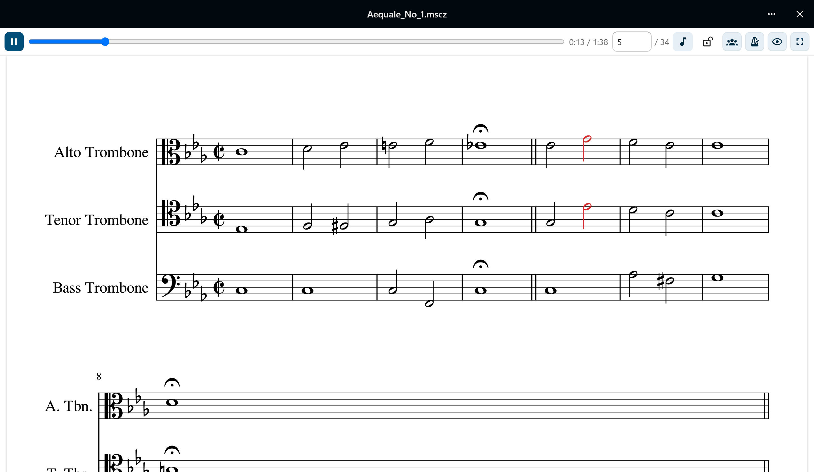
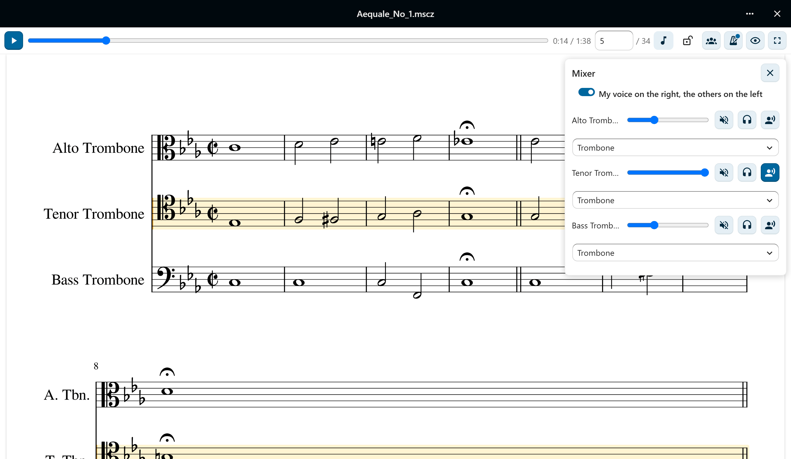
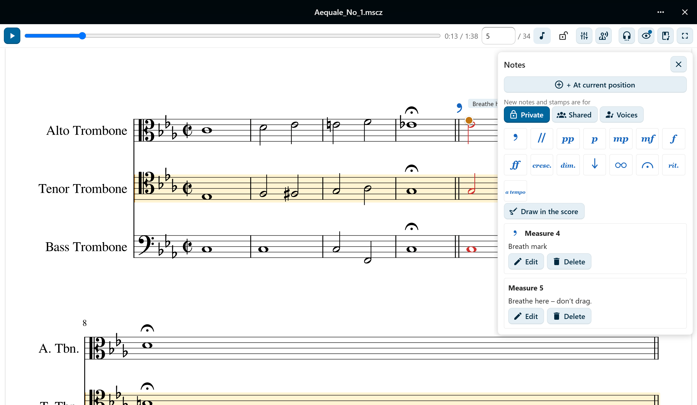
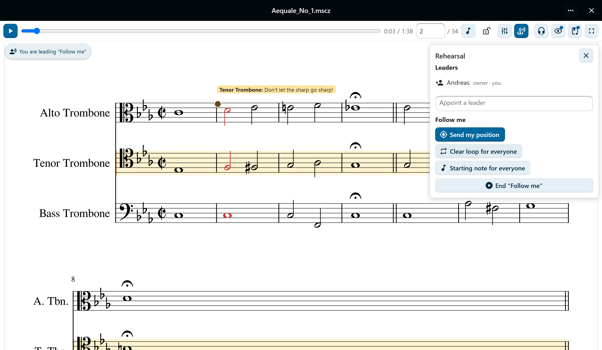
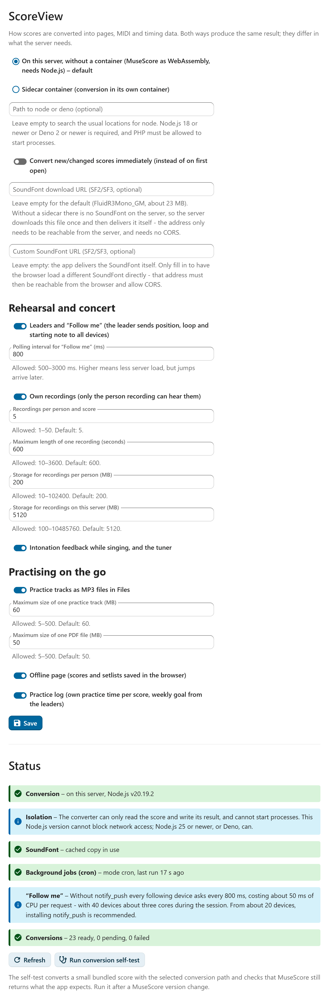

# ScoreView

**English** · [Deutsch](README.de.md)

[](https://github.com/AndiMb/scoreview/actions/workflows/ci.yml)
[](LICENSE)

A Nextcloud app that shows MuseScore scores straight from Files and plays them
back in the browser – as faithful MuseScore notation with a playback cursor
that follows along in sync, instead of as a static PDF export.

Made for choir and ensemble work: the music looks like your own sheet music,
every part can be heard on its own, and every measure is one click away.



## What the app does

**Reading music.** MuseScore's own page rendering as vector graphics – zoom
without loss of quality, zoom presets, full screen, and an autoscroll that keeps
the current measure in the visible band. Each user decides how the sounding
position is marked: colored noteheads or a band, in a color of their choice.

**Hearing what you want to practice.** Playback is synthesized in the browser,
not played from a finished MP3. That is why you can adjust the volume of each
part, mute it or hear it solo, change the tempo in BPM and switch on a
metronome – on every beat or only on the downbeat. "My voice" brings one part
to the front and keeps the others quietly audible.



**Targeted rehearsal.** Measure navigation with an always-visible measure
number, a loop over any range of measures marked in the score, and a click on a
note jumps exactly there.

**Taking notes.** Private, or shared with everyone who can see the file. Notes
are attached to a musical position rather than to pixels, so they survive a
re-render and a re-upload of the same score.



**On a tablet at the music stand.** Touch controls, pinch zoom and a screen
that does not go to sleep during playback. In **Performance mode** only page
turning, zoom and moving to the next piece still work – an accidental tap
triggers nothing – and `PgDn`/`PgUp` or a Bluetooth pedal turn pages so that no
line is lost. Optionally light notes on a dark background; embedded images stay
unchanged.

**Practicing.** The **Starting note** plays, for as long as you hold the button,
the note of your own part at the current position or the tonic of the key. The
app remembers "My voice" per score and, if you like, places it on the right of
the stereo image and the others on the left. The **Speed trainer** raises the
tempo with every pass through the loop until it reaches the target tempo.
**Coach** plays your own part as a loud piano on the right and the others quietly
on the left, and **Transpose** shifts the sound up or down by semitones without
changing the notation.

**Practicing on the go, reading on a phone.** A **practice track** saves exactly
what you are hearing right now – part, coach, tempo, transposition, optionally
only the loop or with metronome – as an MP3 next to the score in Files; the
Nextcloud app plays it offline and with controls on the lock screen. Anyone
allowed to write next to the score can create **Tracks for all parts** with one
click. For reading on a phone, the **system band** lays the systems out side by
side, each as tall as the screen, and the **lyrics view** shows only the text of
your own part with all verses, the sung syllable highlighted. **Note names** can
be shown next to the noteheads – German, English or as solfège – and tapping a
note plays its pitch. With **"Save for offline use"**, a piece or an entire
setlist, sound included, is kept ready in the browser and opens without a
network through the app's offline page.

**In choir rehearsal.** Whoever owns a score appoints **Leaders**, and every
leader can appoint more. Leaders write **notes for voices** that only the
addressed parts see – anyone who has not chosen a part yet sees them dimmed,
with the name of the part. On top of that come **Stamps** (breath mark, caesura,
dynamics, fermata …) that sit at the musical position in the score. Measure
navigation understands **Rehearsal marks**: "C" and "C+3" jump there. With
**"Follow me"** the leader sends the position, loop, starting note and a
transposition to all devices in the room, has them turn pages silently along
with the leader's own playback, and takes them along to the next piece in the
setlist – anyone who navigates on their own detaches and comes back with one
tap.



**In concert.** A **setlist** is a `*.setlist.md` file in Files, a list of links
to scores, editable in the text editor or in ScoreView. In the viewer you go
from piece to piece without Performance mode, zoom or SoundFont being reloaded.

**Hearing yourself.** **Own recordings**, playable in sync with the cursor and
accompaniment, can only be heard by the person who made them. **Intonation
feedback** shows a needle at the cursor while you sing and afterwards the spots
that were too sharp or too flat. The microphone only runs when explicitly
requested, and a red dot shows what for.

This also works in the Nextcloud mobile apps, with a few limitations: the
Android app does not grant access to the microphone; there, "Open in browser"
gets you further. And on mobile a setlist opens through one of its scores
rather than through the file itself. The offline page exists only in the
browser, not in the apps. The lyrics view and note names require the local
conversion path (see below). Administrators can switch off "Follow me",
recording, intonation, practice tracks and the offline page individually; what
the features cost and where they end is described in
[docs/limits.md](docs/limits.md#rehearsal-and-concert-features)
and [docs/limits.md](docs/limits.md#practising-and-reading-on-a-phone).

Keyboard in the viewer: `Space` play/stop · `←` `→` previous/next measure · `L` loop
· `+` `−` zoom · `0` page width · `PgDn` `PgUp` turn pages.

Interface in English and German. Other languages can be contributed, see
[docs/translating.md](docs/translating.md).

## How it works

An uploaded `.mscz` file is converted **once** on the server into score pages
(SVG), MIDI and timing data, and the result is cached. Opening it again does not
re-render; a new conversion is triggered by a change to the file – or by the
"Convert again" button in the viewer, when a newer version of the app lays out
the same score better. Next to it, the viewer shows which of the two paths below
produced the pages on display. Audio playback happens client-side in the
browser, with a SoundFont that the app serves itself.

There are **two equivalent paths** for the conversion. They produce the same
result and differ only in what the server needs for them:

| | **Local** (default) | **Sidecar** |
|---|---|---|
| Requires | Node.js ≥ 18 on the Nextcloud server | a Docker host |
| MuseScore | MuseScore 4.7.5 as WebAssembly, in the app package | real MuseScore 4 in the container |
| Setup | nothing | start the container, enter address and secret |
| Lyrics view, note names, colored noteheads | yes | no |
| Recommended if | you run no containers | you run some anyway |

The local path is the default because it is the only one that is ready right
after `app:enable`. Details in
[docs/architecture.md](docs/architecture.md) (German).

If the server can run **neither of them** – managed hosting without a Node
runtime and without containers – the user's browser does the conversion:
the same engine, the same result, but without a cache and with a one-time
download of a good 7 MB per device
([E7](docs/architecture.md#e7-konvertierung-im-browser-als-rückfall)). This
fallback cannot be selected anywhere and only applies where nothing else would
work at all.

## Requirements

- Nextcloud 31–35, PHP 8.1–8.5
- One of the two conversion paths above – or neither: where managed hosting
  allows neither containers nor a Node runtime, the fallback in the browser
  steps in
  ([E7](docs/architecture.md#e7-konvertierung-im-browser-als-rückfall) (German)).
  Why server-side rendering is not possible there is explained under
  [E3](docs/architecture.md#e3-zwei-konvertierungswege-hinter-einer-api).

## Installation

```sh
occ app:enable scoreview
```

Nothing more is needed for the conversion: the local path is the default, and
everything it needs apart from a Node.js runtime ships in the app package. The
server fetches the SoundFont itself on first playback (~23 MB, FluidR3Mono_GM) –
there is nothing to configure for that either.

If you want to run the sidecar instead, start it in addition, select it under
**Settings → Administration → ScoreView** and allow Nextcloud to access local
addresses (`allow_local_remote_servers`, see the
[guide](docs/installation.md#path-b-sidecar)):

```sh
docker build -t scoreview-musescore-cli sidecar/
docker network create scoreview-net
docker network connect scoreview-net <nextcloud-container>
docker run -d --name scoreview-sidecar --network scoreview-net \
  -e SCOREVIEW_SIDECAR_SECRET="$(openssl rand -hex 32)" \
  --memory=2g --pids-limit=512 scoreview-musescore-cli
```



Either way, one one-time step remains: background jobs in `cron` mode. The
conversion depends on them, and so does registering the mimetype for `.mscz`,
which the app takes care of itself:
**[full guide](docs/installation.md)**.

For "Follow me" with many devices,
[notify_push](https://github.com/nextcloud/notify_push) is worthwhile: without
it, every device polls on its own during a session, which ties up two to three
CPU cores with 40 devices
([setup](docs/installation.md#rehearsal-and-concert)).

## Documentation

| Document | Contents |
|---|---|
| [Installation and configuration](docs/installation.md) | Step-by-step setup, settings, updating |
| [Architecture](docs/architecture.md) (German) | Structure, design decisions, data flow, format fundamentals |
| [Limits and restrictions](docs/limits.md) | Measured values, known gaps, what the app deliberately does not do |
| [Troubleshooting](docs/troubleshooting.md) | Symptoms and what helps |
| [Development](docs/development.md) | Building, testing, conventions, release |
| [Sidecar](sidecar/README.md) | Operation and HTTP API of the conversion service |

What changed from version to version is listed in the
[changelog](CHANGELOG.md).

## Contributing

See [CONTRIBUTING.md](CONTRIBUTING.md) (German). Bugs and feature requests go in
the [issues](https://github.com/AndiMb/scoreview/issues). How to contribute a
translation is described in [docs/translating.md](docs/translating.md).

## License and credits

ScoreView is licensed under AGPL-3.0-or-later, see [LICENSE](LICENSE).

- The engraving and conversion work is done by **MuseScore Studio** (GPL-3.0) –
  in the sidecar as a pinned AppImage, on the local path through the
  [scoreview-engine](https://github.com/AndiMb/scoreview-engine), MuseScore's
  engraving compiled Qt-free to WebAssembly.
- The **SoundFont** for playback is `FluidR3Mono_GM` (MIT) by default, the same
  one that ships with MuseScore. With the sidecar it comes from its MuseScore
  installation (MuseScore General by S. Christian Collins, MIT); otherwise the
  server fetches it from a preset address that can be overridden.
- Practice tracks are encoded in the browser by
  [`@breezystack/lamejs`](https://www.npmjs.com/package/@breezystack/lamejs) (LGPL-3.0).
- The score in the images is Anton Bruckner's *Aequale Nr. 1* in the
  [OpenScore edition](https://musescore.com/openscore/scores/4074271) (CC0).
